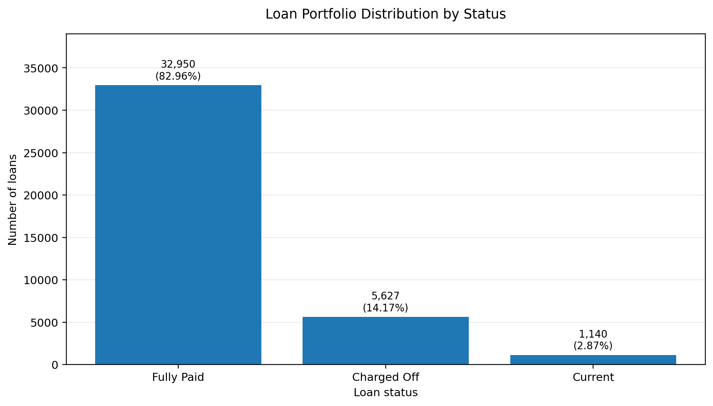
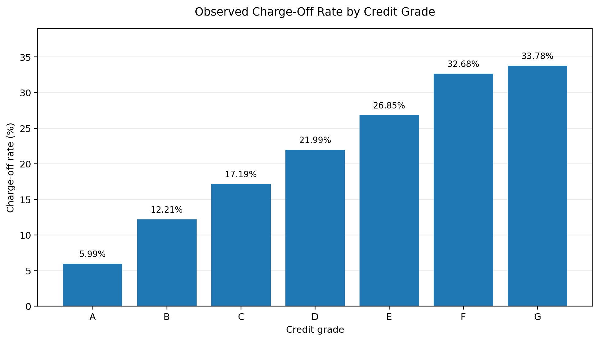
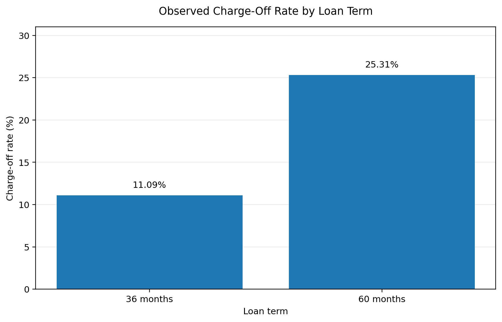
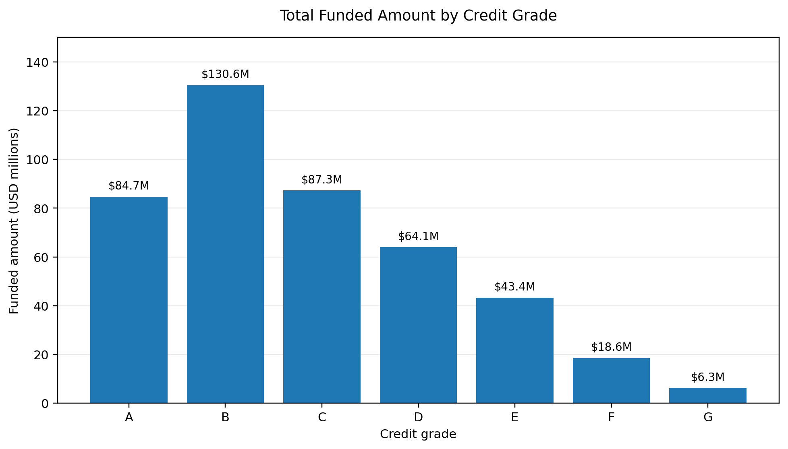

# Loan Portfolio & Credit Risk Analysis

## 1. Project Overview

This project uses PostgreSQL to analyse a historical LendingClub loan
portfolio, examining loan performance, borrower characteristics, credit
risk and funding distribution.

The analysis covers **39,717 individual loans originated between 2007
and 2011**, representing approximately **\$434.81 million in funded loan
value**.

The project follows an end-to-end analytical workflow: raw data
inspection, data cleaning, quality validation, portfolio analysis and
interpretation of business-relevant findings. The objective is to
demonstrate how SQL can transform a wide, initially unprepared dataset
into a structured analytical resource.

## 2. Executive Summary

This project examines a historical LendingClub loan portfolio to
understand repayment outcomes, credit-risk patterns and the distribution
of funded capital.

Using PostgreSQL, I prepared and analysed 39,717 loan records containing
111 original columns. The cleaning process produced an analytical table
with 42 selected fields. The analysis then compared loan outcomes across
credit grades, interest rates, loan terms, borrower characteristics and
credit-history indicators.

### Key findings

-   **Portfolio outcomes:** 82.96% of loans were fully paid, 14.17% were
    charged off and 2.87% were classified as current in the historical
    dataset. The charge-off rate among resolved loans was **14.59%**.
-   **Credit grades:** The observed charge-off rate increased broadly
    from **5.99% for Grade A** to **33.78% for Grade G**. Average
    interest rates also increased across the grades.
-   **Funding concentration:** Grades B and C accounted for
    approximately **50.11% of total funded capital**. Grade B alone
    represented approximately **\$130.55 million**.
-   **Loan term:** The observed charge-off rate was **11.09% for
    36-month loans** and **25.31% for 60-month loans**.
-   **Borrower and credit-history indicators:** Higher revolving credit
    utilisation, more recent credit inquiries, lower annual income and
    higher debt-to-income ratios generally coincided with higher
    observed charge-off rates.

The analysis demonstrates why portfolio risk should be considered from
more than one perspective. The segments with the highest charge-off
rates were not necessarily those with the largest funding exposure.

### Analytical workflow

The work was completed through nine SQL scripts covering database setup,
data profiling, cleaning, validation, portfolio overview, loan
performance, borrower risk, credit risk, and grade and pricing analysis.

### Technical capabilities demonstrated

The project applies PostgreSQL for data import and organisation, type
conversion, missing-value handling, date parsing, data-quality checks,
conditional aggregation, CTEs, `CASE`, `FILTER`, `GROUP BY`, and
comparative portfolio analysis.

### Scope of the findings

This is a historical loan-level snapshot, not a monthly repayment
history. The results describe associations in the available data; they
do not establish causation, predict future defaults or represent current
lending-market conditions.

## 3. Business Problem

Lending institutions must evaluate borrowers while managing the risk of
loan defaults and the allocation of available capital.

An overall repayment rate provides only a partial view of portfolio
performance. It does not show where charge-offs are concentrated, how
outcomes differ across borrower groups, or whether large amounts of
capital are exposed to particular credit segments.

This project addresses that problem by examining historical loan
outcomes alongside loan characteristics, borrower profiles and
credit-history indicators. It also compares charge-off rates with the
distribution of funded capital to provide a broader view of portfolio
exposure.

## 4. Project Objectives

The analysis was guided by the following objectives:

1.  **Assess overall portfolio performance:** Examine loan volumes,
    funded amounts and the distribution of fully paid, charged-off and
    current loans.
2.  **Evaluate credit-grade risk:** Determine how charge-off rates vary
    across credit grades and subgrades.
3.  **Examine loan pricing and terms:** Investigate how interest rates
    and loan duration vary alongside observed loan outcomes.
4.  **Analyse borrower characteristics:** Explore charge-off patterns
    across income, debt-to-income ratio, employment length, home
    ownership and loan purpose.
5.  **Evaluate credit-history indicators:** Investigate delinquencies,
    credit inquiries, revolving credit utilisation, public records,
    bankruptcies, open accounts and credit-history age.
6.  **Assess funding exposure:** Identify how funded capital is
    distributed across credit grades and compare funding concentration
    with observed charge-off rates.
7.  **Translate findings into business insights:** Identify historical
    risk patterns and portfolio concentrations relevant to lending and
    credit-risk monitoring.

## 5. Dataset Overview

### Data source

The project uses a historical LendingClub loan dataset containing
individual loan records and borrower information.

  Dataset characteristic   Description
  ------------------------ ----------------
  Total records            39,717 loans
  Original columns         111
  Origination period       2007--2011
  Original data format     CSV
  Data dictionary          Excel workbook
  Database platform        PostgreSQL

The accompanying data dictionary was used to understand the meaning of
the available fields and their relevance to the analysis.

### Data selection

After profiling the original 111 columns, **42 relevant fields** were
selected for the cleaned analytical table. The fields were organised
into four broad categories:

-   **Loan characteristics:** Loan amount, funded amount, loan term,
    interest rate, installment, credit grade and loan purpose.
-   **Borrower profile:** Employment length, annual income, home
    ownership, verification status, location and debt-to-income ratio.
-   **Credit history:** Previous delinquencies, credit inquiries,
    revolving credit utilisation, public records, open accounts and
    credit-history dates.
-   **Loan performance:** Loan status, outstanding principal, cumulative
    payments, principal and interest received, late fees and recoveries.

Fields such as member identifiers, URLs, descriptions, free-text titles
and constant-value columns were excluded where they did not contribute
to the project objectives. The original imported table was preserved
separately.

## 6. Data Cleaning and Preparation

The raw CSV was imported into PostgreSQL as a staging table, with source
fields initially stored as text. This allowed the data to be profiled
before values were converted into appropriate analytical data types.

### Data type conversion

Fields were converted into suitable PostgreSQL data types, including
numeric types for loan amounts, income, interest rates and credit
indicators; integer types for count-based variables; date types for
relevant dates; and text types for categorical fields.

### Missing-value handling

Literal `NA` entries were converted into SQL `NULL` values where
appropriate. The employment-length value `n/a` was also treated as
missing rather than as a genuine employment category.

### Percentage standardisation

Percentage symbols were removed from fields such as interest rate and
revolving credit utilisation. Values were stored numerically as
percentage points. For example, `12.02%` was stored as `12.02`, not
`0.1202`.

### Date standardisation

Date fields supplied in month-year format were converted into PostgreSQL
date values using the first day of the corresponding month.

A date interpretation issue was identified in `earliest_cr_line`, where
two-digit years could be interpreted in the wrong century. A
chronology-based correction was applied: where the interpreted
credit-history date fell after the loan's issue date, 100 years were
subtracted. This corrected **127 records** and eliminated the chronology
violations identified during validation.

### Data retention decisions

Unusual values were not automatically treated as errors. For example,
unusually high annual income values and differences between
investor-funded amounts and total funded amounts were retained where
they were valid source observations. Small payment and principal
discrepancies were investigated rather than automatically deleted or
adjusted.

The objective was to preserve the information contained in the source
data while correcting formatting, representation and identifiable date
interpretation issues.

### Clean analytical dataset

The cleaning process produced `analytics.loan_clean`, containing
**39,717 records and 42 selected columns**. The original imported data
remained in `staging.loan_raw`, maintaining a separation between the
source and cleaned analytical datasets.

## 7. Data Quality Assurance and Validation

Following data cleaning, validation checks were performed to assess the
completeness, consistency and structural integrity of the analytical
dataset.

### Record integrity and reconciliation

The cleaned dataset was compared directly against the original staging
table. The reconciliation confirmed:

-   39,717 records in the original dataset.
-   39,717 records in the cleaned dataset.
-   All 39,717 loan identifiers matched between the two tables.
-   No original loan identifiers were missing from the cleaned dataset.
-   No additional loan identifiers appeared in the cleaned dataset.
-   No duplicate or missing loan identifiers were identified.

These checks established that the cleaning process preserved the full
set of loan records.

### Missing-value and completeness checks

Missing values were reviewed in the context of each field rather than
automatically treated as errors. For example:

-   `next_pymnt_d` was populated for 1,140 loans, corresponding to loans
    classified as Current.
-   `last_pymnt_d` was missing for 71 records.
-   Credit-history fields such as months since last delinquency and
    months since last public record contained substantial missingness.

### Date consistency

Date validation included checking the chronological relationship between
loan origination dates and borrowers' earliest recorded credit-history
dates. The century correction applied during cleaning resolved 127
incorrectly interpreted dates, with no remaining chronology violations
identified in the final checks.

### Funding and payment consistency

Financial validation checks examined relationships between requested
loan amounts, funded amounts and investor-funded amounts. The checks
confirmed:

-   No records where total funded amount exceeded the requested loan
    amount.
-   No records where investor funding exceeded total funding.
-   129 records had zero investor-funded amounts.
-   Differences between investor payment totals and overall payment
    totals were investigated; observed differences were consistent with
    small precision or rounding variations.
-   Small cases where principal received exceeded the original loan
    amount were retained after investigation rather than automatically
    removed.

### Loan performance consistency

Additional checks examined the distribution of payment components,
recoveries and outstanding principal across loan statuses. Recoveries
and collection recovery fees were concentrated in loans classified as
Charged Off, while recorded outstanding principal was associated with
loans classified as Current.

### Validation outcome

The checks established that the cleaned dataset retained all source loan
identifiers and passed the structural, chronology and financial
relationship checks performed for this project. These checks support
internal consistency; they do not independently verify the accuracy of
every original source record.

## 8. Analytical Methodology and SQL Approach

The analysis was organised into nine SQL scripts, each addressing a
distinct stage of the workflow.

### SQL analysis workflow

  -----------------------------------------------------------------------------
  Script                                     Focus            Purpose
  ------------------------------------------ ---------------- -----------------
  `01_data_loading_and_setup.sql`            Database setup   Establishes
                                                              database schemas
                                                              and examines the
                                                              imported source
                                                              table.

  `02_data_profiling.sql`                    Data profiling   Examines column
                                                              structures,
                                                              missing values,
                                                              distributions and
                                                              numerical ranges.

  `03_data_cleaning.sql`                     Data preparation Converts data
                                                              types,
                                                              standardises
                                                              values and
                                                              creates the
                                                              cleaned
                                                              analytical table.

  `04_data_quality_validation.sql`           Data validation  Checks record
                                                              integrity,
                                                              completeness,
                                                              chronology and
                                                              financial
                                                              consistency.

  `05_portfolio_overview.sql`                Portfolio        Examines loan
                                             overview         volumes, funding,
                                                              origination
                                                              trends, terms and
                                                              credit-grade
                                                              pricing.

  `06_loan_performance_analysis.sql`         Loan performance Compares loan
                                                              outcomes, payment
                                                              components,
                                                              recoveries and
                                                              recorded
                                                              outstanding
                                                              principal.

  `07_borrower_risk_analysis.sql`            Borrower risk    Examines
                                                              charge-off
                                                              patterns across
                                                              borrower
                                                              characteristics
                                                              and loan
                                                              purposes.

  `08_credit_risk_analysis.sql`              Credit-history   Investigates
                                             risk             previous
                                                              delinquencies,
                                                              credit inquiries,
                                                              utilisation and
                                                              other credit
                                                              indicators.

  `09_grade_and_pricing_risk_analysis.sql`   Grade and        Compares credit
                                             pricing risk     grades,
                                                              subgrades,
                                                              interest rates,
                                                              charge-off rates
                                                              and funding
                                                              exposure.
  -----------------------------------------------------------------------------

### Analytical methodology

The project uses descriptive and comparative analysis to examine
historical loan outcomes across portfolio segments.

The same charge-off rate definition was applied throughout the borrower,
credit-history and grade-level risk analysis:

**Charge-off rate = Charged-off loans ÷ (Fully Paid loans + Charged-off
loans) × 100**

Only loans with resolved outcomes were included in the denominator.
Loans classified as Current were excluded because their final outcomes
had not been established in the dataset.

### Analytical dimensions

The investigation covered several complementary dimensions:

-   **Portfolio composition:** Loan counts, requested amounts, funded
    amounts and origination trends.
-   **Loan performance:** Fully Paid, Charged Off and Current statuses,
    cumulative payments, recoveries and recorded outstanding principal.
-   **Credit classification and pricing:** Grade, subgrade and
    interest-rate comparisons.
-   **Borrower characteristics:** Income, debt-to-income ratio,
    employment length, home ownership and loan purpose.
-   **Credit history:** Delinquencies, recent inquiries, revolving
    credit utilisation, public records, bankruptcies, open accounts and
    credit-history age.
-   **Funding exposure:** Distribution of funded capital across credit
    grades and comparison with observed charge-off rates.

### PostgreSQL techniques

The analysis demonstrates practical use of PostgreSQL features,
including:

-   Common Table Expressions (CTEs) for organising multi-stage queries.
-   Aggregate functions such as `COUNT`, `SUM`, `AVG`, `MIN` and `MAX`.
-   Conditional aggregation using `FILTER` and `CASE`.
-   Date parsing, conversion and date-based calculations.
-   `GROUP BY` and `ORDER BY` for segmentation and comparison.
-   `NULLIF` to handle zero denominators safely.
-   Percentage calculations and rounding for reporting.
-   JSONB-based inspection of missing values during data profiling.
-   Schema management and table creation to separate source data from
    analytical data.

## 9. Key Findings and Visualisations

### 9.1 Overall portfolio performance

The analysis covered **39,717 loans** with a total funded amount of
approximately **\$434.81 million**.

  Loan status     Number of loans   Share of portfolio
  ------------- ----------------- --------------------
  Fully Paid               32,950               82.96%
  Charged Off               5,627               14.17%
  Current                   1,140                2.87%
  **Total**            **39,717**             **100%**

Among resolved loans, the overall charge-off rate was **14.59%**.

### 9.2 Credit grade and risk

Charge-off rates increased broadly as credit grades moved from A to G.
Average interest rates also increased across the grades.

  Grade     Average interest rate   Charge-off rate
  ------- ----------------------- -----------------
  A                         7.34%             5.99%
  B                        11.02%            12.21%
  C                        13.55%            17.19%
  D                        15.72%            21.99%
  E                        17.71%            26.85%
  F                        19.75%            32.68%
  G                        21.40%            33.78%

The broad pattern shows higher observed charge-off rates in lower credit
grades. The subgrade analysis was not perfectly linear at every
individual subgrade.

### 9.3 Loan term and performance

  Loan term     Number of loans   Share of portfolio   Charge-off rate
  ----------- ----------------- -------------------- -----------------
  36 months              29,096               73.26%            11.09%
  60 months              10,621               26.74%            25.31%

The historical portfolio showed a higher charge-off rate among 60-month
loans. This is an observed relationship and does not establish that the
longer term caused the higher charge-off rate.

### 9.4 Borrower characteristics

The analysis identified differences in charge-off rates across income
levels, debt-to-income ratios and loan purposes.

-   **Annual income:** Borrowers in the lowest income band (up to
    \$25,000) had a 19.14% charge-off rate, compared with 10.58% among
    borrowers earning above \$250,000.
-   **Debt-to-income ratio:** The observed rate increased from 12.37% in
    the 0--5% DTI group to 17.00% in the 20.01--25% group.
-   **Loan purpose:** Small-business loans recorded the highest
    charge-off rate among the listed purposes, at 27.08%. Debt
    consolidation accounted for the largest number of loans.

These patterns describe differences in historical portfolio outcomes and
should not be interpreted as evidence of causation.

### 9.5 Credit history and risk indicators

Revolving credit utilisation showed a consistent increase in charge-off
rates across the analysed bands.

  Revolving utilisation     Charge-off rate
  ----------------------- -----------------
  0--20%                              9.92%
  20.01--40%                         11.88%
  40.01--60%                         14.70%
  60.01--80%                         16.92%
  Above 80%                          20.09%

Other indicators also showed differences:

-   Borrowers with no recent credit inquiries recorded a 12.19%
    charge-off rate, compared with 20.75% among those with three
    inquiries.
-   Borrowers with no recorded delinquencies had a 14.35% rate, compared
    with 19.32% among those with two delinquencies.

Some categories contained relatively few loans. Their rates should
therefore be interpreted cautiously.

### 9.6 Funding exposure across credit grades

The distribution of funded capital provides additional context beyond
charge-off rates.

-   Grades B and C together accounted for approximately **50.11% of
    total funded capital**.
-   Grade B had the largest funded amount, at approximately **\$130.55
    million**.
-   Grades F and G together represented approximately **5.71% of total
    funding**.
-   Although grades F and G had the highest charge-off rates, Grade B
    recorded the largest number of charged-off loans, with 1,425.

This demonstrates why portfolio risk should be assessed using both the
likelihood of charge-off and the amount of capital exposed.

### 9.7 Visualisations

The charts below summarise key portfolio and credit-risk findings from
the SQL analysis.

**Loan status distribution**



**Charge-off rate by credit grade**



**Charge-off rate by loan term**



**Charge-off rate by revolving credit utilisation**


**Funded amount by credit grade**



## 10. Business Insights and Implications

The analysis highlights several areas a lending institution could
consider when assessing credit risk, setting lending strategies and
monitoring portfolio exposure.

### 10.1 Credit grades provide a useful risk segmentation framework

Charge-off rates increased broadly from Grade A to Grade G, rising from
5.99% to 33.78%. This indicates that the historical credit grading
system distinguished groups with substantially different observed loan
outcomes.

**Business implication:** Credit grades can support portfolio
segmentation and risk monitoring. Lenders should monitor performance
across both grades and subgrades rather than relying exclusively on an
overall portfolio average.

### 10.2 Portfolio concentration matters as much as individual risk rates

Grades F and G had the highest charge-off rates, but together
represented approximately 5.71% of funded capital. Grades B and C
accounted for approximately 50.11% of funding. Grade B also recorded the
largest number of charged-off loans, at 1,425.

**Business implication:** Risk management should consider both the rate
of adverse outcomes and the amount of capital exposed. A segment with a
lower charge-off rate but substantial funding can still have significant
implications for total portfolio performance.

### 10.3 Longer-term loans showed higher historical charge-off rates

The observed charge-off rate was 25.31% for 60-month loans, compared
with 11.09% for 36-month loans.

**Business implication:** Loan term should be included in portfolio
monitoring and risk segmentation. Lenders could examine whether
longer-term products require different underwriting criteria, pricing
assumptions or monitoring arrangements. This analysis does not establish
that loan duration itself caused the difference.

### 10.4 Borrower affordability indicators deserve attention

Lower-income groups and borrowers with higher debt-to-income ratios
generally recorded higher charge-off rates in the analysed portfolio.

**Business implication:** Income and existing debt obligations can be
useful dimensions in borrower risk assessment. They should be considered
alongside other credit indicators rather than used as standalone
decision rules.

### 10.5 Credit utilisation can help identify higher-risk segments

Borrowers with revolving credit utilisation above 80% recorded a 20.09%
charge-off rate, compared with 9.92% among those in the 0--20% band.

**Business implication:** Revolving credit utilisation may provide a
useful signal for portfolio monitoring. Lenders could pay attention to
borrowers with high utilisation when reviewing overall credit exposure
and affordability.

### 10.6 Loan purpose should be considered in portfolio monitoring

Small-business loans recorded the highest observed charge-off rate among
the analysed loan-purpose categories, at 27.08%. Debt consolidation,
however, accounted for the largest number of loans.

**Business implication:** Loan purpose can help lenders understand where
portfolio risk is concentrated. Smaller loan-purpose categories should
be assessed with their underlying sample sizes in mind before drawing
strong conclusions.

### 10.7 Overall business takeaway

Credit risk cannot be understood through a single metric. A more
complete assessment considers the likelihood of charge-off across
segments, the amount of capital allocated to each segment, borrower
affordability, credit-history indicators, loan characteristics and the
number of loans supporting each observed rate.

## 11. Technical Skills Demonstrated

This project demonstrates practical PostgreSQL skills across data
preparation, quality assurance, analytical querying and business
reporting.

### Data import and database organisation

-   Imported raw CSV data into PostgreSQL.
-   Organised database objects using separate `staging` and `analytics`
    schemas.
-   Preserved the original imported dataset while creating a separate
    cleaned analytical table.
-   Selected relevant fields from a wide dataset containing 111 original
    columns.

### Data cleaning and transformation

-   Converted text-based source fields into appropriate numeric and date
    data types.
-   Handled missing values and inconsistent representations, including
    `NA` and `n/a`.
-   Removed percentage symbols and converted percentage fields into
    numeric values.
-   Corrected two-digit-year interpretation issues in credit-history
    dates.
-   Applied conditional logic to standardise and transform source data.
-   Retained unusual but valid observations rather than automatically
    deleting or capping them.

### Data quality assurance

-   Checked record counts and unique loan identifiers between staging
    and cleaned tables.
-   Tested for duplicate identifiers, missing records and unexpected
    records.
-   Validated date chronology and field completeness.
-   Checked relationships between requested, funded and investor-funded
    loan amounts.
-   Examined payment components, recoveries and outstanding principal in
    the context of loan status.
-   Investigated numerical differences and potential rounding
    discrepancies.

### Analytical SQL techniques

  ---------------------------------------------------------------------
  SQL technique                      Application
  ---------------------------------- ----------------------------------
  Common Table Expressions (CTEs)    Organising multi-step analytical
                                     queries

  Aggregate functions                Calculating counts, totals,
                                     averages and medians

  `CASE` expressions                 Creating risk bands and
                                     classifying records

  `FILTER`                           Calculating conditional metrics
                                     within grouped results

  `GROUP BY`                         Segmenting portfolio performance

  Window functions                   Supporting comparative and ranked
                                     analysis

  `NULLIF`                           Preventing division-by-zero errors

  Date and text functions            Parsing and standardising source
                                     fields

  Conditional calculations           Deriving charge-off rates and
                                     other portfolio measures

  `ORDER BY`                         Ranking and presenting analytical
                                     results
  ---------------------------------------------------------------------

### Analytical interpretation and reporting

-   Structured SQL-derived findings into a multi-sheet Excel reporting
    workbook.
-   Presented portfolio metrics, risk segments, funding exposure and
    data-quality results in a business-facing format.

Beyond writing SQL queries, the project required translating results
into business-relevant findings. This included distinguishing between
risk rates and total capital exposure, interpreting small sample sizes
cautiously, documenting analytical assumptions and avoiding unsupported
causal conclusions.

## 12. Project Structure

The repository contains the nine SQL scripts, the Excel reporting
workbook and the exported visualisations.

``` text
loan-portfolio-analysis/
│
├── data/
│   └── raw/
│       ├── loan.csv
│       └── Data_Dictionary.xlsx
│
├── results/
│   ├── loan-status-distribution.png
│   ├── charge-off-by-grade.png
│   ├── charge-off-by-term.png
│   ├── charge-off-by-revolving-utilisation.png
│   └── funded-amount-by-grade.png
│
├── reports/
│   └── Loan_Portfolio_Analysis.xlsx
│
├── sql/
│   ├── 01_data_loading_and_setup.sql
│   ├── 02_data_profiling.sql
│   ├── 03_data_cleaning.sql
│   ├── 04_data_quality_validation.sql
│   ├── 05_portfolio_overview.sql
│   ├── 06_loan_performance_analysis.sql
│   ├── 07_borrower_risk_analysis.sql
│   ├── 08_credit_risk_analysis.sql
│   └── 09_grade_and_pricing_risk_analysis.sql
│
└── README.md
```

-   `data/raw/` --- Original loan dataset and data dictionary, included
    subject to the source dataset's redistribution terms.
-   `results/` --- Five exported charts covering portfolio composition,
    credit-grade risk, loan-term risk, revolving utilisation and funding
    distribution.
-   `reports/` --- The seven-sheet Excel workbook containing SQL-derived
    portfolio, performance, grade, borrower-risk, credit-risk, funding
    and data-quality summaries.
-   `sql/` --- Nine SQL scripts arranged in execution order.
-   `README.md` --- Project overview, methodology, findings,
    visualisations, technical skills and execution instructions.

## 13. How to Run the Project

### Prerequisites

To reproduce the analysis, you will need:

-   PostgreSQL installed and running.
-   A PostgreSQL client such as pgAdmin or `psql`.
-   The original loan dataset in CSV format.
-   The accompanying data dictionary for reference.

### Step 1: Create the database

Create a PostgreSQL database:

``` sql
CREATE DATABASE loan_portfolio_db;
```

Connect to `loan_portfolio_db` before executing the project scripts.

### Step 2: Import the raw dataset

Import the original CSV file into the staging table:

``` text
staging.loan_raw
```

The source fields are initially loaded as text to allow profiling and
controlled data-type conversion during cleaning. Adjust the import
location, file path and import options to match your local environment
and the setup script.

### Step 3: Execute the SQL scripts in order

Run the nine scripts from the `sql/` directory in the following
sequence:

  -------------------------------------------------------------------------------
               Order SQL script                                 Purpose
  ------------------ ------------------------------------------ -----------------
                   1 `01_data_loading_and_setup.sql`            Database and
                                                                schema setup

                   2 `02_data_profiling.sql`                    Initial dataset
                                                                inspection and
                                                                profiling

                   3 `03_data_cleaning.sql`                     Data
                                                                transformation
                                                                and creation of
                                                                the cleaned table

                   4 `04_data_quality_validation.sql`           Validation of the
                                                                cleaned dataset

                   5 `05_portfolio_overview.sql`                Overall portfolio
                                                                analysis

                   6 `06_loan_performance_analysis.sql`         Loan outcomes and
                                                                payment analysis

                   7 `07_borrower_risk_analysis.sql`            Borrower
                                                                characteristics
                                                                and risk patterns

                   8 `08_credit_risk_analysis.sql`              Credit-history
                                                                indicators and
                                                                risk patterns

                   9 `09_grade_and_pricing_risk_analysis.sql`   Credit grades,
                                                                subgrades,
                                                                interest rates
                                                                and funding
                                                                exposure
  -------------------------------------------------------------------------------

Execute each script completely before moving to the next one.

### Step 4: Review the analytical results

The cleaned analytical table is:

``` text
analytics.loan_clean
```

The final analytical scripts query this table to produce portfolio
summaries, performance measures and risk comparisons. The five exported
charts are stored in the `results/` directory. The accompanying
`reports/Loan_Portfolio_Analysis.xlsx` workbook organises the
established SQL outputs into seven worksheets for business-facing
review. It is a reporting deliverable based on the SQL results, not an
independent recalculation of the underlying loan-level dataset.

### Important execution note

The data-cleaning script recreates the cleaned analytical table. If you
rerun it, an existing `analytics.loan_clean` table may be replaced.
Preserve any outputs you need before repeating that stage.

The original staging table, `staging.loan_raw`, should remain unchanged
throughout the workflow.

### Reproducibility

The scripts are organised to make the analysis reproducible from the raw
dataset through to the final analytical outputs. Database names, file
paths, import options and local connection settings may need to be
adapted to the environment in which the project is run.

## 14. Limitations and Assumptions

The analysis is based on a historical, loan-level LendingClub dataset
covering loans originated between 2007 and 2011. Findings should be
interpreted within the scope and limitations of the available data.

### Historical dataset

The dataset represents historical lending activity from 2007--2011. It
does not reflect current lending conditions, borrower behaviour,
interest rates or credit-market conditions. The findings describe
historical portfolio patterns and should not be treated as a
representation of present-day credit risk.

### Loan-level snapshot rather than monthly repayment history

The source data contains one record per loan rather than a complete
month-by-month repayment history. Although it includes cumulative
payment information and recorded loan outcomes, it does not provide a
complete monthly timeline of repayments, missed payments or outstanding
balances.

The analysis therefore focuses on recorded loan outcomes and available
financial information. It does not reconstruct monthly repayment
behaviour or calculate historical loan balances over time.

### Current loan status

The dataset includes loans classified as Fully Paid, Charged Off and
Current. Current loans had not reached a final outcome in the available
snapshot and are excluded from the denominator when calculating
charge-off rates.

The charge-off rate is calculated as:

**Charged-off loans ÷ (Fully Paid loans + Charged-off loans) × 100**

This prevents unresolved loans from being treated as either successful
repayments or charge-offs.

### Descriptive analysis, not predictive modelling

The project identifies relationships between loan outcomes and
characteristics such as credit grade, income, debt-to-income ratio, loan
term and credit history. These are descriptive associations. The
analysis does not establish that any individual characteristic caused a
loan to be charged off.

The project does not include a trained predictive model,
probability-of-default estimation, model validation or out-of-sample
performance testing.

### Data quality and source limitations

The analysis depends on the accuracy and completeness of the original
source dataset. Although profiling, cleaning and validation checks were
performed, these checks establish internal consistency rather than
independently verifying every source record.

Some fields contain missing values or categories with relatively few
observations. Findings from small groups should therefore be interpreted
cautiously.

### Date precision

Several date fields in the source data are recorded at month-level
precision rather than exact daily precision. For analytical consistency,
these values were represented using the first day of the recorded month.
This does not imply that the underlying event occurred on that exact
day.

### Retention of unusual values

Unusually high or low values were not automatically removed or capped.
Values were retained unless there was a clear data-quality reason to
change them. This preserves the original distribution but means that
extreme observations may influence certain averages and segment-level
results.

### Interpretation of financial fields

Cumulative payments received, principal repayments, interest payments,
recoveries and outstanding principal represent different financial
measures. Total payments received should not be interpreted as lender
profit, and recorded outstanding principal should not be interpreted as
a present-day loan balance.

### Scope of conclusions

The findings demonstrate historical portfolio analysis, credit-risk
segmentation and funding exposure using PostgreSQL. They should not be
used as standalone lending policies, current credit-market benchmarks or
definitive assessments of individual borrowers.

Further analysis using more recent data, complete repayment histories
and predictive modelling would be required to support those
applications.

## 15. Conclusion

This project demonstrates an end-to-end PostgreSQL workflow for
analysing a historical loan portfolio and identifying patterns
associated with credit risk and loan performance.

Working with 39,717 loan records and 111 original fields, the project
involved raw data profiling, data cleaning, date standardisation, data
quality validation and the development of a structured analytical
dataset containing 42 selected fields.

The analysis examined portfolio composition, repayment outcomes, credit
grades, interest-rate pricing, loan terms, borrower characteristics,
credit-history indicators and funding exposure.

Several important patterns emerged. Charge-off rates increased broadly
across lower credit grades, longer-term loans recorded higher historical
charge-off rates, and borrowers with higher revolving credit utilisation
generally had higher charge-off rates. The funding analysis also
demonstrated that the segments with the highest risk rates were not
necessarily those with the largest capital exposure.

The final outcome is a documented SQL analysis demonstrating data
preparation, validation, multi-dimensional analysis and the ability to
communicate technical results in a business context.

**The project reinforces an important principle of credit portfolio
analysis: understanding risk requires examining not only the likelihood
of adverse outcomes, but also borrower and loan characteristics and the
amount of capital exposed.**
